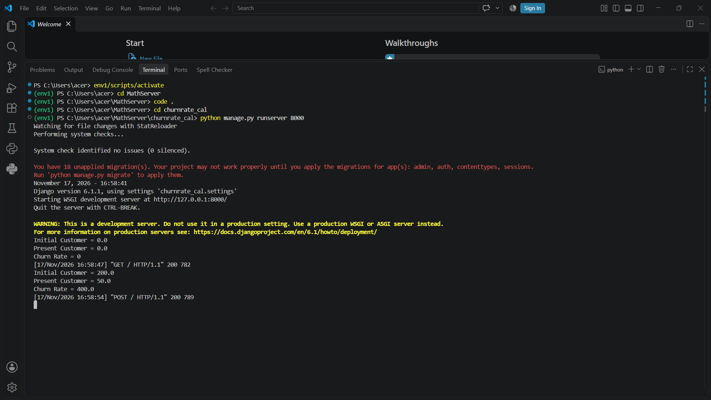
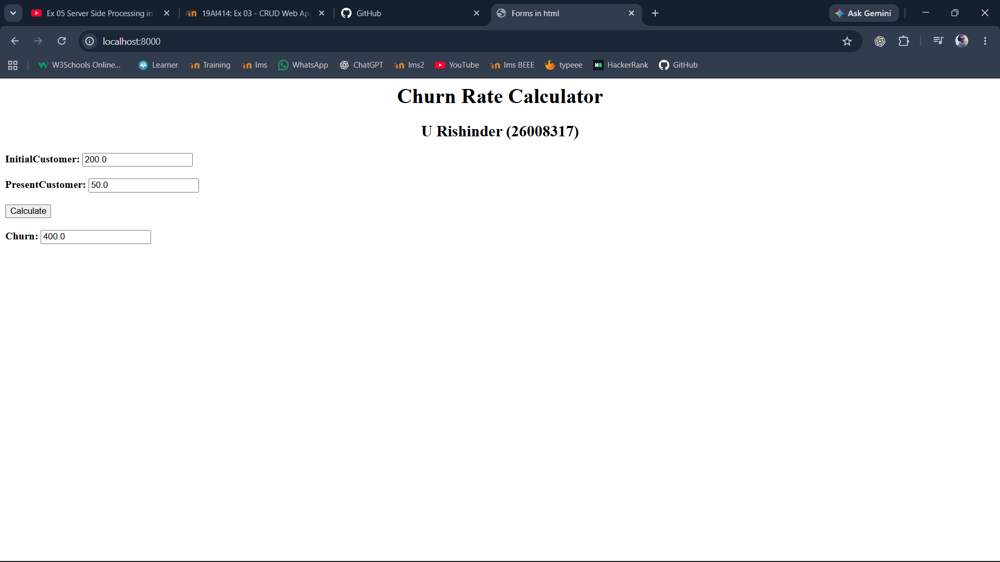

# Ex.03 Design a Website for Server Side Processing
## Date:10.11.2026

## AIM:
To create a web page to calculate Churn Rate using server-side scripts.

## FORMULA:
Churn Rate = (CustLost / InitCust) * 100
<br> InitCust --> Initial Customers Count
<br> CustLost --> Customers Lost Count

## DESIGN STEPS:

### Step 1:
Clone the repository from GitHub.

### Step 2:
Create Django Admin project.

### Step 3:
Create a New App under the Django Admin project.

### Step 4:
Create a HTML file to implement form based input and output.

### Step 5:
Create python programs for views and urls to perform server side processing.

### Step 6:
Receive input values from the form using request.POST.get().

### Step 7:
Calculate the Result using the given formula.

### Step 8:
Display the calculated result in the server console.

### Step 9:
Render the result to the HTML template.

### Step 10:
Publish the website in Localhost.

## PROGRAM:
```
churn.html

<html>
    <head>
        <title>Forms in html</title>
    </head>
    <body>
        <h1 align="center">Churn Rate Calculator</h1>
        <h2 align="center"><b>U Rishinder (26008317)</b></h2>
        <form method="post">
            
            <label><b>InitialCustomer: </b></label>
            <input type="text" name="initialCust" value="{{IniCus}}"><br><br>
            <label><b>PresentCustomer: </b></label>
            <input type="text" name="presentcust" value="{{PreCus}}"><br><br>
            <input type="submit" value="Calculate"><br><br>
            <label><b>Churn: </b></label>
            <input type="text" value="{{churn}}">
        </form>
    </body>
</html>

views.py

from django.shortcuts import render
def Churn_rate(request):
    IniCus = float(request.POST.get('initialCust', '0'))
    PreCus = float(request.POST.get('presentcust', '0'))
    churn = (IniCus/PreCus)*100   if request.method == 'POST' else 0
    print("Initial Customer =",IniCus)
    print("Present Customer =",PreCus)
    print("Churn Rate =",churn)
    return render(request, 'myapp/churn.html',{'IniCus': IniCus, 'PreCus': PreCus, 'churn': churn})

urls.py

    
from django.contrib import admin
from django.urls import path
from myapp import views

urlpatterns = [path('', views.Churn_rate, name='Churn_rate'),]
```

## OUTPUT - SERVER SIDE:


## OUTPUT - WEBPAGE:


## RESULT:
The the web page to calculate Churn Rate using server-side scripts is created successfully.
